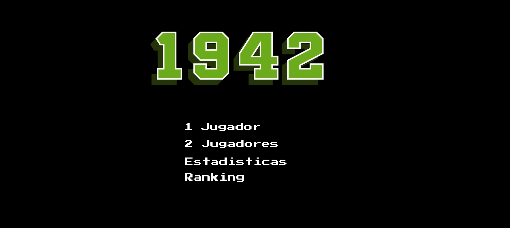

# 1942 · Juego arcade con estadísticas de partidas

Proyecto académico grupal desarrollado con **Processing en modo Java**. El jugador controla un avión, enfrenta escuadrones de enemigos y avanza hasta un jefe final. Las partidas se registran en CSV para consultar un ranking y estadísticas globales o por jugador.

**Tecnologías:** Processing · Java · programación orientada a objetos · archivos CSV.

*Recurso gráfico del menú. La opción «2 jugadores» que aparece en esta imagen todavía no está implementada.*

## Funcionalidades

- Modo de un jugador con identificador de tres letras.
- Tres niveles, escuadrones con distintos recorridos y un jefe final con fases de ataque.
- Movimiento con teclado, disparos, colisiones, vidas e invulnerabilidad temporal.
- Mejoras de escudo, multidisparo y disparo de alto daño.
- Pantallas de inicio, partida, resultado, estadísticas y ranking.
- Registro de puntaje, duración, enemigos derrotados, precisión y resultado de cada partida.
- Estadísticas con máximo, mínimo, media, desvío estándar muestral y porcentaje de victorias.
- Ranking de las diez partidas con mayor puntaje.

## Ejecutar el proyecto

### Requisitos

| Componente | Uso |
|---|---|
| [Processing](https://processing.org/download), modo **Java** | Abrir y ejecutar los archivos `.pde`. |
| [GifAnimation](https://github.com/extrapixel/gif-animation) | Animaciones del avión y las explosiones. |
| [Video](https://processing.org/reference/libraries/video/) | El código conserva el import `processing.video.*` y el método `movieEvent(Movie m)`. |

La versión exacta del entorno de desarrollo no quedó registrada en el proyecto. Conviene usar inicialmente la versión con la que el equipo lo ejecutó y anotar aquí esa versión y las de sus bibliotecas al validar la instalación.

### Pasos

1. Descargá el repositorio con **Code → Download ZIP** y extraelo, o clonalo con Git.
2. Abrí Processing y seleccioná el modo **Java**.
3. En **Sketch → Import Library → Add Library**, instalá **GifAnimation** y **Video**. Si GifAnimation no aparece en el administrador, su repositorio explica cómo instalarla manualmente en la carpeta de bibliotecas de Processing.
4. Abrí `Algo1_TPI_1942/Algo1_TPI_1942.pde`.
5. Presioná **Run**. En el menú, elegí **1 Jugador**, ingresá tres letras y presioná **Espacio**.

La carpeta `Algo1_TPI_1942` y su archivo principal deben conservar el mismo nombre. Los demás `.pde` son pestañas del mismo sketch; Processing los integra al ejecutarlo. Conservá también la carpeta `data` con sus recursos y su CSV.

La ventana se configura en **800 × 600** con un objetivo de **60 cuadros por segundo**. El fondo activo es una imagen; el soporte de video permanece como una dependencia del código original.

## Controles

| Contexto | Tecla | Acción |
|---|---|---|
| Menú | ↑ / ↓ | Cambiar de opción. |
| Menú | Espacio | Seleccionar. |
| Ingreso de jugador | Letras, Retroceso, Tab | Escribir el ID, borrar o volver. |
| Ingreso de jugador | Espacio | Iniciar cuando el ID tiene tres letras. |
| Partida | Flechas | Mover el avión. |
| Partida | Espacio | Disparar. |
| Estadísticas | Espacio | Abrir el filtro por jugador. |
| Filtro | Letras + Enter | Consultar un ID; `ALL` muestra los datos globales. |
| Filtro | Tab | Cancelar. |
| Estadísticas y ranking | R | Volver al menú. |
| Desarrollo | K | Saltar de nivel; en el tercero marca la partida como ganada. |

El atajo **K** también puede generar resultados guardados. Evitá usarlo en partidas que quieras considerar representativas del juego normal.

## Organización del código

| Archivo o grupo | Responsabilidad |
|---|---|
| `Algo1_TPI_1942.pde` | Inicialización, recursos y ciclo principal de Processing. |
| `GameManager.pde` | Navegación entre pantallas y manejo de entradas. |
| `Pantalla*.pde` | Interfaz del menú, juego, resultado, estadísticas y ranking. |
| `Partida.pde` | Niveles, enemigos, proyectiles, colisiones y registro de partidas. |
| `Avion*.pde` | Clase base, jugador, enemigos y jefe final. |
| `Escuadron*.pde` y `Curva.pde` | Formaciones y recorridos de los enemigos. |
| `Bala.pde`, `Colision.pde`, `PowUp.pde`, `Explosion.pde` | Proyectiles, detección de impactos, mejoras y animación. |
| `Estadisticas.pde` | Cálculos globales y por jugador. |
| `data/` | Imágenes, animaciones, fuente y datos de partidas. |

Todas estas rutas parten de `Algo1_TPI_1942/`.

## Datos de partidas

El archivo `Algo1_TPI_1942/data/data.csv` contiene los registros incluidos con el proyecto y recibe nuevas filas al terminar una partida. La duración se guarda en milisegundos; la interfaz la muestra en segundos o minutos y segundos.

El ranking ordena **partidas**, por lo que un mismo jugador puede aparecer varias veces. El [diccionario de datos](docs/DATOS.md) describe las columnas y los cálculos.

## Conceptos que permite mostrar

- Clases abstractas, herencia y especialización de comportamientos.
- Colecciones de objetos para gestionar enemigos y proyectiles.
- Separación entre pantallas, coordinación del juego y entidades.
- Geometría de colisiones y trayectorias parametrizadas.
- Lectura y escritura de datos tabulares, filtrado, ordenamiento y estadística descriptiva.

## Estado y próximos pasos

Esta versión conserva los **29 archivos de código originales**. Se revisaron la estructura, los recursos referenciados y los enlaces de la documentación. La compilación y una partida completa en Processing quedan pendientes de validación.

- Completar o retirar la opción de dos jugadores.
- Registrar versiones del entorno y agregar una captura de una partida real.
- Separar el modo de prueba del ranking normal.
- Hacer más robusta la carga del CSV y evitar releerlo en cada cuadro de la pantalla de estadísticas.

La [revisión técnica](docs/REVISION.md) detalla estas mejoras y una prueba manual sugerida.

## Equipo y procedencia

El historial incluido en la entrega apunta al repositorio [fabros81/Algo1_TPI_1942](https://github.com/fabros81/Algo1_TPI_1942) y contiene contribuciones de varias personas. Esta publicación presenta el proyecto grupal; los [créditos](docs/CREDITOS.md) conservan la procedencia y la información disponible sobre los recursos.

## Referencias

- [Entorno de Processing: sketches, pestañas y bibliotecas](https://processing.org/environment/).
- [Catálogo de bibliotecas de Processing](https://processing.org/reference/libraries/).
- [GifAnimation: instalación y uso](https://github.com/extrapixel/gif-animation).
